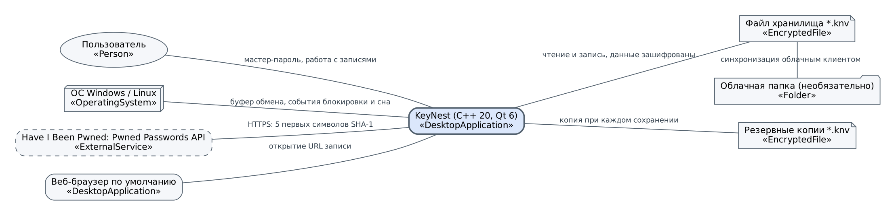
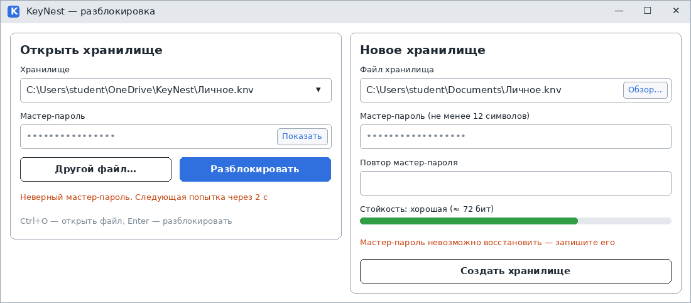
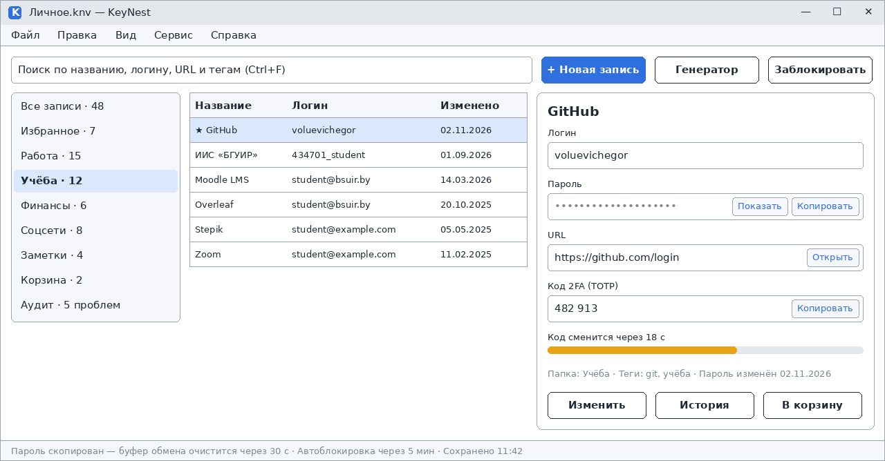
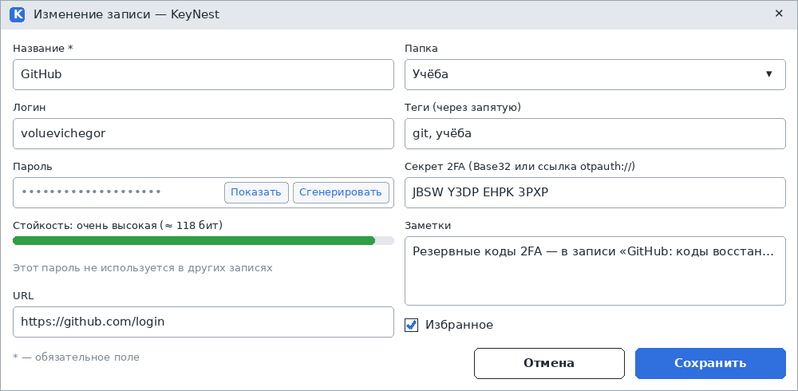
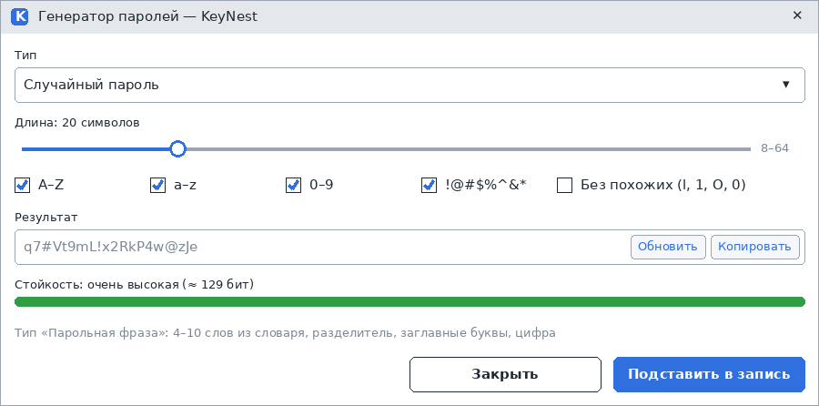
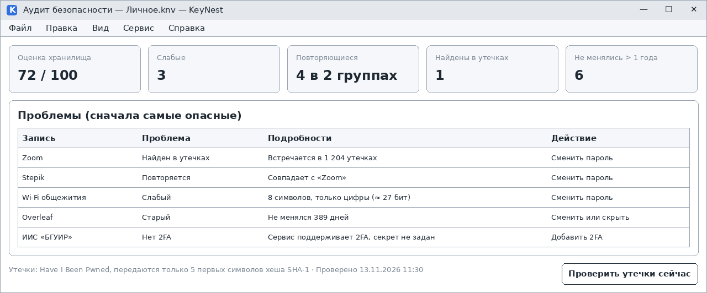
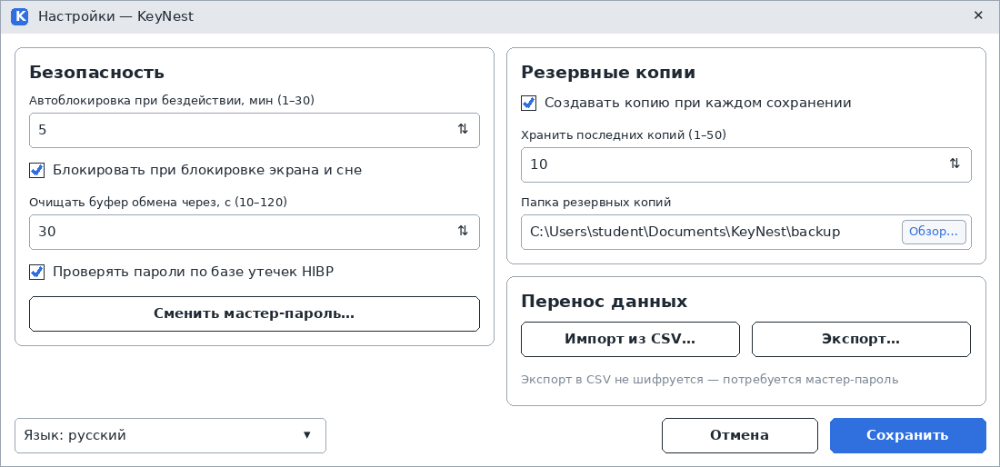
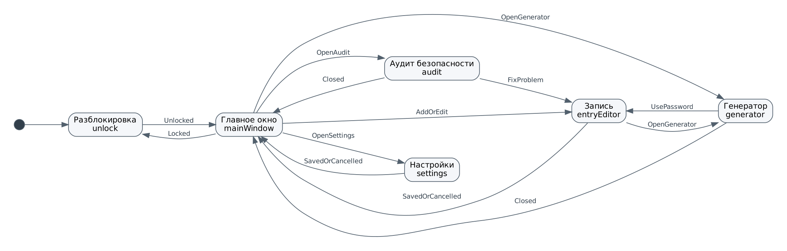

# Спецификация требований к ПО

Для KeyNest — настольного менеджера паролей

Версия 0.1

Подготовил Волуевич Е.А., гр. 434701

БГУИР, факультет компьютерных систем и сетей, кафедра ЭВМ

2026-11-13

## Оглавление

<!-- TOC -->
* [1. Введение](#1-introduction)
  * [1.1 Назначение документа](#11-document-purpose)
  * [1.2 Область применения продукта](#12-product-scope)
  * [1.3 Определения, акронимы и сокращения](#13-definitions-acronyms-and-abbreviations)
  * [1.4 Ссылки](#14-references)
  * [1.5 Обзор документа](#15-document-overview)
* [2. Обзор продукта](#2-product-overview)
  * [2.1 Перспектива продукта](#21-product-perspective)
  * [2.2 Функции продукта](#22-product-functions)
  * [2.3 Ограничения продукта](#23-product-constraints)
  * [2.4 Характеристики пользователей](#24-user-characteristics)
  * [2.5 Допущения и зависимости](#25-assumptions-and-dependencies)
  * [2.6 Распределение требований](#26-apportioning-of-requirements)
* [3. Требования](#3-requirements)
  * [3.1 Внешние интерфейсы](#31-external-interfaces)
    * [3.1.1 Пользовательские интерфейсы](#311-user-interfaces)
    * [3.1.2 Аппаратные интерфейсы](#312-hardware-interfaces)
    * [3.1.3 Программные интерфейсы](#313-software-interfaces)
  * [3.2 Функциональные требования](#32-functional)
  * [3.3 Качество обслуживания](#33-quality-of-service)
    * [3.3.1 Производительность](#331-performance)
    * [3.3.2 Безопасность](#332-security)
    * [3.3.3 Надёжность](#333-reliability)
    * [3.3.4 Доступность](#334-availability)
    * [3.3.5 Наблюдаемость](#335-observability)
  * [3.4 Соответствие стандартам](#34-compliance)
  * [3.5 Проектирование и реализация](#35-design-and-implementation)
    * [3.5.1 Установка](#351-installation)
    * [3.5.2 Сборка и поставка](#352-build-and-delivery)
    * [3.5.3 Распределение](#353-distribution)
    * [3.5.4 Сопровождаемость](#354-maintainability)
    * [3.5.5 Повторное использование](#355-reusability)
    * [3.5.6 Переносимость](#356-portability)
    * [3.5.7 Стоимость](#357-cost)
    * [3.5.8 Сроки](#358-deadline)
    * [3.5.9 Доказательство концепции](#359-proof-of-concept)
    * [3.5.10 Управление изменениями](#3510-change-management)
  * [3.6 ИИ/МО](#36-aiml)
* [4. Верификация](#4-verification)
* [5. Приложения](#5-appendixes)
<!-- TOC -->

## История изменений

| Name | Date | Reason For Changes | Version |
|------|------|--------------------|---------|
| Волуевич Е.А. | 2026-11-13 | Первоначальная версия: бизнес-требования по итогам интервью с Заказчиком (Приложение Б), требования к ПО, модели SysML v2 и мокапы окон | 0.1 |

---

## 1. Введение {#1-introduction}

Документ описывает требования к KeyNest — настольному менеджеру паролей для Windows и Linux, который хранит логины, пароли, коды двухфакторной аутентификации и защищённые заметки в одном зашифрованном файле на компьютере пользователя. KeyNest — учебный проект, который разрабатывается на C++ в течение всего курса «Жизненный цикл разработки программного обеспечения».

### 1.1 Назначение документа {#11-document-purpose}

SRS фиксирует, **что** должна делать система KeyNest версии 1.0, и служит согласованной основой для Заказчика, менеджера проекта, разработчика и тестировщика. Заказчик проверяет по документу, что его бизнес-требования поняты верно; разработчик использует его как исходные данные для проектирования (SDD, ADR) и реализации; тестировщик — как источник критериев приёмки. Способ реализации («как») описывается в документах `sdd/` и `adr/` этого репозитория.

### 1.2 Область применения продукта {#12-product-scope}

**Продукт:** KeyNest, релиз 1.0.

**Проблема.** У обычного пользователя — десятки учётных записей: почта, соцсети, учебные и рабочие системы, банки, магазины. Запомнить для каждой отдельный стойкий пароль невозможно, поэтому люди используют один-два пароля везде, записывают их в блокнот или текстовый файл либо полагаются на браузер. Утечка базы одного сервиса открывает злоумышленнику доступ ко всем остальным. Облачные менеджеры паролей решают задачу, но часть пользователей не готова доверять свои пароли чужому серверу или платить подписку.

**Бизнес-цели:**

| ID | Бизнес-цель | Показатель успеха |
|----|-------------|-------------------|
| BG-1 | Пользователь использует уникальный стойкий пароль для каждого сервиса, запоминая только один мастер-пароль | Новые пароли создаются генератором со стойкостью не менее 80 бит; через месяц использования в хранилище нет повторяющихся паролей, созданных после начала работы с KeyNest |
| BG-2 | Данные остаются под контролем пользователя | Хранилище — один зашифрованный файл на устройстве пользователя; у продукта нет собственного сервера, пароли и их хеши целиком никогда не передаются по сети |
| BG-3 | Выявить и устранить уже существующие слабые, повторяющиеся и скомпрометированные пароли | Аудит безопасности показывает проблемные записи и оценку хранилища 0–100; за первый месяц число проблемных записей уменьшается не менее чем вдвое |
| BG-4 | Пароль под рукой быстрее, чем «вспомнить и набрать» | В разблокированном хранилище пароль нужной записи копируется не более чем за 3 действия пользователя (поиск, выбор, копирование) |
| BG-5 | Не потерять доступ к данным | Повреждение или случайное изменение файла не приводит к потере данных: есть резервные копии и атомарное сохранение; формат файла открыт и документирован |
| BG-6 | Нулевая стоимость для пользователя | Продукт бесплатен, распространяется с открытым исходным кодом и использует только бесплатные компоненты |

**Входит в рамки:** создание, разблокировка и блокировка зашифрованного хранилища; записи типа «логин» и «защищённая заметка»; папки, теги, избранное, поиск; копирование в буфер обмена с автоочисткой; генератор паролей и парольных фраз; оценка стойкости; аудит безопасности, в том числе проверка утечек через Have I Been Pwned; коды двухфакторной аутентификации TOTP; история паролей; смена мастер-пароля; импорт из CSV браузеров; экспорт; резервные копии; настройки.

**Не входит в рамки:** собственный сервер и облачная синхронизация (пользователь может сам поместить файл хранилища в папку облачного диска); восстановление забытого мастер-пароля; браузерные расширения и автозаполнение форм; автонабор (auto-type); мобильные приложения и macOS; совместный доступ к записям нескольких пользователей; хранение банковских карт и документов как отдельных типов записей; вложенные файлы; аппаратные ключи (YubiKey) и вход по биометрии.

Границы системы показаны на контекстной диаграмме в разделе 2.1.

### 1.3 Определения, акронимы и сокращения {#13-definitions-acronyms-and-abbreviations}

| Term | Definition |
|------|------------|
| 2FA | Two-Factor Authentication — двухфакторная аутентификация: вход по паролю и дополнительному коду |
| API | Application Programming Interface — набор определений и протоколов для создания и интеграции прикладного ПО |
| Argon2id | Функция формирования ключа из пароля, устойчивая к перебору на GPU (RFC 9106) |
| CSPRNG | Cryptographically Secure Pseudo-Random Number Generator — криптографически стойкий генератор случайных чисел |
| CSV | Comma-Separated Values — текстовый формат табличных данных |
| HIBP | Have I Been Pwned — общедоступный сервис проверки паролей и адресов по базе утечек |
| SRS | Software Requirements Specification — документ, описывающий назначение, требования и характер ПО |
| SysML v2 | Systems Modeling Language версии 2 — язык моделирования систем с текстовой нотацией |
| TOTP | Time-based One-Time Password — одноразовый код, зависящий от времени (RFC 6238) |
| UI | User Interface — визуальная часть приложения, через которую пользователь взаимодействует с ПО |
| XChaCha20-Poly1305 | Алгоритм аутентифицированного шифрования: шифрует данные и обнаруживает любое их изменение |
| Аудит безопасности | Проверка всех записей хранилища на слабые, повторяющиеся, старые и скомпрометированные пароли |
| Блокировка | Закрытие доступа к расшифрованным данным: ключ и данные удаляются из памяти, открывается окно разблокировки |
| Запись | Единица хранения: логин (название, логин, пароль, URL, секрет TOTP, теги, заметки) или защищённая заметка (название, текст, теги) |
| Корзина | Папка, куда попадают удалённые записи; из неё запись можно восстановить или удалить окончательно |
| Мастер-пароль | Единственный пароль, который помнит пользователь; из него формируется ключ шифрования хранилища. Нигде не хранится |
| Мокап | Схематичное изображение окна, показывающее состав и расположение элементов интерфейса |
| Оценка хранилища | Число 0–100, отражающее долю записей без проблем, найденных аудитом (REQ-FUNC-013) |
| Парольная фраза | Пароль из нескольких случайных слов словаря, разделённых символом |
| Скомпрометированный пароль | Пароль, найденный в базе утечек HIBP |
| Стойкость пароля | Оценка числа попыток для подбора пароля, выраженная в битах энтропии (REQ-FUNC-012) |
| Хранилище | Зашифрованный файл с расширением `.knv`, содержащий все записи, папки и настройки хранилища |

### 1.4 Ссылки {#14-references}

| Источник | Владелец, версия | Статус | Расположение |
|----------|------------------|--------|--------------|
| ISO/IEC/IEEE 29148:2018 Systems and software engineering — Life cycle processes — Requirements engineering | ISO/IEC/IEEE, 2018 | Справочная | [docs/](../docs/) |
| Шаблон SRS | Кафедра ЭВМ БГУИР, 2026 | Нормативная | [srs-template.md](srs-template.md) |
| RFC 6238 TOTP: Time-Based One-Time Password Algorithm | IETF, 2011 | Нормативная | <https://www.rfc-editor.org/rfc/rfc6238> |
| RFC 9106 Argon2 Memory-Hard Function | IETF, 2021 | Нормативная | <https://www.rfc-editor.org/rfc/rfc9106> |
| Pwned Passwords API | Have I Been Pwned, v3 | Нормативная | <https://haveibeenpwned.com/API/v3#PwnedPasswords> |
| Key Uri Format (`otpauth://`) | Google Authenticator wiki | Нормативная | <https://github.com/google/google-authenticator/wiki/Key-Uri-Format> |
| NIST SP 800-63B Digital Identity Guidelines: Authentication | NIST, ред. 4 | Справочная | <https://pages.nist.gov/800-63-4/sp800-63b.html> |
| OWASP Password Storage Cheat Sheet | OWASP | Справочная | <https://cheatsheetseries.owasp.org/cheatsheets/Password_Storage_Cheat_Sheet.html> |
| libsodium documentation | libsodium, 1.0.20 | Справочная | <https://doc.libsodium.org/> |
| Модели SysML v2: библиотека элементов UI | Волуевич Е.А., 0.1 | Нормативная | [models/UiKit.sysml](models/UiKit.sysml) |
| Модели SysML v2: мокапы окон | Волуевич Е.А., 0.1 | Нормативная | [models/Mockups.sysml](models/Mockups.sysml) |
| Модели SysML v2: контекст и карта окон | Волуевич Е.А., 0.1 | Нормативная | [models/Context.sysml](models/Context.sysml) |

### 1.5 Обзор документа {#15-document-overview}

Раздел 2 описывает контекст продукта, его функции, ограничения, пользователей и допущения. Раздел 3 содержит верифицируемые требования с идентификаторами вида `REQ-[AREA]-[NNN]`; слово «должна» обозначает обязательное требование, «следует» — желательное. Раздел 4 содержит матрицу верификации, раздел 5 — перечень графических материалов, вопросы к Заказчику с принятыми решениями и журнал замечаний по pull request. Изменения вносятся через pull request в ветку `main` и фиксируются в таблице «История изменений»; изменённое требование получает суффикс версии (`-2`, `-3`).

---

## 2. Обзор продукта {#2-product-overview}

### 2.1 Перспектива продукта {#21-product-perspective}

KeyNest — новый самостоятельный продукт, не являющийся частью более крупной системы. Это настольное приложение без серверной части: все данные хранятся в зашифрованном файле, расположение которого выбирает пользователь. Если файл помещён в папку облачного диска (OneDrive, Яндекс Диск, Google Drive и т. п.), синхронизацию между компьютерами выполняет клиент облачного диска, а не KeyNest. Единственный внешний сетевой сервис — Pwned Passwords API (HIBP) для проверки паролей по базе утечек. Владелец продукта — Заказчик; разработку и сопровождение в рамках курса выполняет автор документа. Соглашения об уровне обслуживания не заключаются.

Рисунок 2.1 — Контекстная диаграмма (модель: [models/Context.sysml](models/Context.sysml), часть `systemContext`)

### 2.2 Функции продукта {#22-product-functions}

- **Хранилище:** создание зашифрованного файла с мастер-паролем, разблокировка, ручная и автоматическая блокировка, смена мастер-пароля.
- **Записи:** логины и защищённые заметки; папки, теги, избранное; корзина; история паролей.
- **Быстрый доступ:** мгновенный поиск, копирование логина, пароля и кода 2FA в буфер обмена с автоочисткой, открытие URL в браузере.
- **Генератор:** случайные пароли и парольные фразы с настраиваемыми параметрами и оценкой стойкости.
- **Аудит безопасности:** слабые, повторяющиеся, старые и найденные в утечках пароли, оценка хранилища.
- **Коды 2FA:** вычисление одноразовых кодов TOTP для записей с секретом.
- **Перенос данных:** импорт из CSV браузеров, экспорт в зашифрованный файл и CSV.
- **Сохранность:** атомарное сохранение и резервные копии с восстановлением.

### 2.3 Ограничения продукта {#23-product-constraints}

| ID | Ограничение | Тип |
|----|-------------|-----|
| CON-1 | Продукт должен быть настольным приложением для Windows 10/11 x64 и Linux x64 (Ubuntu 22.04 и новее) | Обязательное, внешнее |
| CON-2 | Продукт должен быть реализован на C++20 с графическим интерфейсом на Qt 6 (Qt Widgets) и сборкой CMake в папке `project/` репозитория | Обязательное, внутреннее |
| CON-3 | Криптографические операции должны выполняться только средствами открытой проверенной библиотеки libsodium; собственные реализации криптографических алгоритмов запрещены | Обязательное, внутреннее |
| CON-4 | У продукта не должно быть собственного сервера; данные пользователя хранятся только в файлах, расположение которых он выбирает | Обязательное, внешнее |
| CON-5 | Должны использоваться только бесплатные компоненты со свободными лицензиями, совместимыми с распространением продукта в открытом исходном коде | Обязательное, внешнее |
| CON-6 | Основной язык интерфейса и документации — русский | Обязательное, внешнее |
| CON-7 | Продукт не должен собирать телеметрию и показывать рекламу | Обязательное, внешнее |
| CON-8 | Исходный код и документация должны вестись в Git-репозитории, изменения — через pull request | Обязательное, внутреннее |

### 2.4 Характеристики пользователей {#24-user-characteristics}

У продукта одна роль — владелец хранилища; права внутри хранилища не разграничиваются. Классы пользователей различаются поведением:

| Класс | Описание | Подготовка | Частота использования | Цели |
|-------|----------|------------|-----------------------|------|
| Обычный пользователь | Студент или сотрудник 17–45 лет, 30–150 учётных записей, сейчас хранит пароли в браузере, блокноте или запоминает 2–3 «универсальных» пароля | Уверенно пользуется Windows и браузером, о криптографии знает мало | Ежедневно, несколько раз в день — копирование паролей; раз в месяц — аудит | Не вспоминать пароли, не бояться утечек, не потерять доступ |
| Опытный пользователь | IT-специалист или студент технической специальности, 150–1000 записей, использует 2FA, переносит файл хранилища между ПК через облачный диск | Понимает назначение мастер-пароля, 2FA, резервных копий | Ежедневно | Полный контроль над данными, быстрый доступ с клавиатуры, импорт из других менеджеров |

Интерфейс — на русском языке (английский — желательно, REQ-FUNC-020), форматы дат — `дд.мм.гггг`. Интерфейс должен быть полностью доступен с клавиатуры и корректно масштабироваться на мониторах с высокой плотностью пикселей.

### 2.5 Допущения и зависимости {#25-assumptions-and-dependencies}

| ID | Допущение или зависимость | Влияние, если неверно | Мера |
|----|---------------------------|------------------------|------|
| ASM-1 | Пользователь запоминает мастер-пароль или хранит его в надёжном месте | Данные хранилища теряются безвозвратно | Предупреждение при создании хранилища (REQ-FUNC-001), требование к длине мастер-пароля |
| ASM-2 | Компьютер пользователя не заражён вредоносным ПО (кейлоггером, программой чтения памяти) | Мастер-пароль и данные могут быть перехвачены — защитить от этого прикладная программа не может | Фиксируется как ограничение модели угроз (REQ-SEC-003) |
| ASM-3 | Pwned Passwords API остаётся бесплатным и доступным без ключа | Проверка утечек недоступна | Остальные проверки аудита работают без сети (REQ-AVAIL-001) |
| ASM-4 | Если файл помещён в облачную папку, облачный клиент синхронизирует его целиком | Возможна рассинхронизация версий на разных ПК | Резервные копии (REQ-FUNC-019) |
| ASM-5 | Число записей в одном хранилище не превышает 5000 | Потребуется пересмотр требований к производительности | Целевые показатели в 3.3.1 |
| ASM-6 | Системные часы компьютера синхронизированы с точностью до 30 с | Коды TOTP будут неверными | Предупреждение в справке; допуск ±1 период при проверке не требуется (код проверяет сервис) |
| DEP-1 | Qt 6.5 LTS и новее, libsodium 1.0.18 и новее, nlohmann/json, GoogleTest, словарь EFF Large Wordlist | Замена компонента потребует изменения проектных решений | Фиксируется в ADR |

### 2.6 Распределение требований {#26-apportioning-of-requirements}

| Инкремент | Содержание | Требования |
|-----------|------------|------------|
| 1 — MVP | Хранилище и шифрование, записи, папки, поиск, буфер обмена, генератор | REQ-FUNC-001 … 012; REQ-INT-002, 003; REQ-SEC-001 … 008; REQ-REL-001; REQ-PERF-001, 002 |
| 2 | Аудит безопасности, проверка утечек, коды 2FA, история паролей, резервные копии | REQ-FUNC-013 … 015, 019; REQ-INT-001; REQ-REL-002; REQ-OBS-001 |
| 3 | Смена мастер-пароля, импорт, экспорт, настройки, английский интерфейс, установщики | REQ-FUNC-016 … 018, 020; REQ-INST-001; REQ-BUILD-001 |
| Отложено | Браузерное расширение и автозаполнение, автонабор, собственная синхронизация, мобильные версии, macOS, совместный доступ, карты и документы как типы записей, вложения, аппаратные ключи | Вне релиза 1.0 |

---

## 3. Требования {#3-requirements}

Схема идентификаторов: `REQ-[AREA]-[NNN]`. Каждое требование описано по шаблону: Statement, Rationale, Acceptance Criteria, Verification Method, More Information. Эталонный ПК для проверки нефункциональных требований: процессор уровня Intel Core i5 8-го поколения, 8 ГБ ОЗУ, SSD, Windows 10 x64.

### 3.1 Внешние интерфейсы {#31-external-interfaces}

#### 3.1.1 Пользовательские интерфейсы {#311-user-interfaces}

Интерфейс состоит из главного окна и модальных диалогов. Мокапы построены из модели [models/Mockups.sysml](models/Mockups.sysml) на элементах библиотеки [models/UiKit.sysml](models/UiKit.sysml); элементы библиотеки соответствуют стандартным виджетам Qt 6. Данные на мокапах вымышленные.

Рисунок 3.1 — Разблокировка и создание хранилища (`UnlockMockup`)

Рисунок 3.2 — Главное окно (`MainWindowMockup`)

Рисунок 3.3 — Добавление и изменение записи (`EntryEditorMockup`)

Рисунок 3.4 — Генератор паролей и парольных фраз (`GeneratorMockup`)

Рисунок 3.5 — Аудит безопасности (`AuditMockup`)

Рисунок 3.6 — Настройки (`SettingsMockup`)

Рисунок 3.7 — Карта окон (модель: [models/Context.sysml](models/Context.sysml), `state def ScreenFlow`)

Общие правила интерфейса:

- **Клавиатура.** Все функции доступны без мыши. Обязательные сочетания: `Ctrl+N` — новая запись, `Ctrl+F` — поиск, `Ctrl+E` — изменить запись, `Ctrl+B` — копировать логин, `Ctrl+C` — копировать пароль, `Ctrl+T` — копировать код 2FA, `Ctrl+U` — открыть URL, `Ctrl+G` — генератор, `Ctrl+L` — заблокировать, `Delete` — в корзину, `Ctrl+S` — сохранить.
- **Скрытые значения.** Пароли и секреты TOTP по умолчанию показываются точками (REQ-FUNC-009).
- **Пустые состояния.** Пустая папка показывает подсказку «Нет записей. Нажмите „+ Новая запись“ или Ctrl+N»; пустой результат поиска — «Ничего не найдено по запросу „…“».
- **Ошибки.** Сообщения об ошибках формулируются на русском языке, без технических кодов, и подсказывают, что делать дальше.
- **Подтверждение.** Необратимые действия (окончательное удаление, очистка корзины, экспорт в CSV, замена хранилища резервной копией) требуют подтверждения.
- **Оформление.** Светлая и тёмная темы по настройке ОС; масштабирование 100–200 % без обрезки текста; контраст текста не ниже 4,5:1 (WCAG 2.1, уровень AA).

#### 3.1.2 Аппаратные интерфейсы {#312-hardware-interfaces}

Специальных аппаратных интерфейсов нет. Продукт работает на стандартном ПК с клавиатурой, мышью и монитором с разрешением не менее 1280×720. Аппаратные ключи безопасности не поддерживаются (отложено).

#### 3.1.3 Программные интерфейсы {#313-software-interfaces}

- **ID:** REQ-INT-001
- **Title:** Проверка паролей по базе утечек HIBP
- **Statement:** Система должна проверять пароли записей по базе утечек через Pwned Passwords API методом k-анонимности, не передавая по сети ни пароль, ни его полный хеш.
- **Rationale:** BG-3: повторно использованные пароли из утечек — основная причина взлома учётных записей; BG-2: пароль не должен покидать устройство.
- **Acceptance Criteria:**
  - для каждого пароля вычисляется хеш SHA-1, на `https://api.pwnedpasswords.com/range/{первые 5 символов хеша}` отправляется только префикс из 5 шестнадцатеричных символов с заголовком `Add-Padding: true`; сравнение остатка хеша выполняется локально;
  - одинаковые префиксы запрашиваются один раз за проверку;
  - проверка включена по умолчанию, её можно отключить в настройках (REQ-FUNC-020); при отключённой проверке сетевые запросы не выполняются;
  - проверка запускается кнопкой «Проверить утечки сейчас» и автоматически не чаще одного раза в 24 часа при разблокировке;
  - таймаут запроса — 10 с; при ошибке сети аудит показывает «Проверка утечек недоступна: нет подключения» и результаты остальных проверок.
- **Verification Method:** Test (перехват сетевого трафика: в запросах только 5-символьные префиксы)
- **More Information:** Рисунок 3.5; REQ-FUNC-013, REQ-COMP-002.

- **ID:** REQ-INT-002
- **Title:** Буфер обмена операционной системы
- **Statement:** Система должна помещать копируемые значения в буфер обмена ОС так, чтобы они по возможности не попадали в историю буфера обмена и облачную синхронизацию буфера.
- **Rationale:** История буфера обмена Windows (Win+V) и синхронизация буфера между устройствами хранят скопированные пароли неограниченно долго.
- **Acceptance Criteria:**
  - в Windows скопированное значение помечается форматами `ExcludeClipboardContentFromMonitorProcessing` и `CanIncludeInClipboardHistory = 0`, `CanUploadToCloudClipboard = 0`; после копирования пароля он отсутствует в журнале Win+V;
  - в Linux (X11 и Wayland) значение помещается в системный буфер обмена; при наличии `x-kde-passwordManagerHint` устанавливается значение `secret`;
  - очистка буфера выполняется по REQ-SEC-005.
- **Verification Method:** Test
- **More Information:** REQ-FUNC-008.

- **ID:** REQ-INT-003
- **Title:** Формат файла хранилища
- **Statement:** Система должна хранить данные в файле `.knv` документированного формата, одинакового для всех поддерживаемых платформ.
- **Rationale:** BG-5: открытый формат позволяет проверить защищённость и не зависеть от одной программы; файл переносится между Windows и Linux.
- **Acceptance Criteria:**
  - файл состоит из открытого заголовка (сигнатура `KNV1`, версия формата, параметры Argon2id, соль, nonce) и зашифрованного содержимого; заголовок аутентифицируется вместе с содержимым;
  - расшифрованное содержимое — документ JSON в UTF-8 со списком записей, папок, корзины и истории;
  - формат описан в `docs/vault-format.md`;
  - файл, созданный в Windows, открывается в Linux и наоборот;
  - файл с неизвестной более новой версией формата не открывается с сообщением «Хранилище создано более новой версией KeyNest. Обновите приложение».
- **Verification Method:** Inspection, Test
- **More Information:** REQ-SEC-001, REQ-CM-001.

### 3.2 Функциональные требования {#32-functional}

#### Хранилище

- **ID:** REQ-FUNC-001
- **Title:** Создание хранилища
- **Statement:** Система должна позволять создать новое хранилище, указав путь к файлу и мастер-пароль с подтверждением.
- **Rationale:** BG-1, BG-2.
- **Acceptance Criteria:**
  - мастер-пароль короче 12 символов или не совпадающий с подтверждением отклоняется с пояснением;
  - при вводе мастер-пароля отображается индикатор стойкости (REQ-FUNC-012); при стойкости ниже 60 бит выводится предупреждение, но создание не запрещается;
  - перед созданием выводится предупреждение «Мастер-пароль невозможно восстановить. Если вы его забудете, данные будут потеряны»; создание возможно только после отметки «Я понимаю»;
  - существующий файл не перезаписывается без отдельного подтверждения;
  - после создания хранилище открыто и пусто, а путь добавлен в список недавних хранилищ.
- **Verification Method:** Test
- **More Information:** Рисунок 3.1; REQ-SEC-001, REQ-SEC-002.

- **ID:** REQ-FUNC-002
- **Title:** Разблокировка хранилища
- **Statement:** Система должна открывать хранилище после ввода верного мастер-пароля.
- **Rationale:** Без мастер-пароля данные недоступны никому, включая разработчика.
- **Acceptance Criteria:**
  - при запуске предлагается последнее открытое хранилище; список недавних хранит до 5 путей (пути, а не пароли);
  - при неверном мастер-пароле выводится «Неверный мастер-пароль»; повреждённый или изменённый посторонними файл даёт сообщение «Файл хранилища повреждён или изменён» и предложение открыть резервную копию (REQ-REL-002);
  - после неудачных попыток действует задержка по REQ-SEC-006;
  - при успешной разблокировке открывается главное окно с папкой «Все записи».
- **Verification Method:** Test
- **More Information:** Рисунок 3.1; REQ-PERF-001.

- **ID:** REQ-FUNC-003
- **Title:** Блокировка хранилища
- **Statement:** Система должна блокировать хранилище по команде пользователя, по таймеру бездействия, при блокировке экрана или переходе ОС в сон и при сворачивании в область уведомлений.
- **Rationale:** Открытое хранилище на оставленном без присмотра компьютере — прямой доступ ко всем паролям.
- **Acceptance Criteria:**
  - команда «Заблокировать» (кнопка, `Ctrl+L`) немедленно закрывает все окна с данными и показывает окно разблокировки;
  - несохранённые изменения перед блокировкой сохраняются автоматически;
  - после блокировки ключ и расшифрованные данные удаляются из памяти (REQ-SEC-003), буфер обмена очищается, если в нём значение из KeyNest;
  - автоматическая блокировка — по REQ-SEC-004.
- **Verification Method:** Test
- **More Information:** Рисунок 3.2.

#### Записи

- **ID:** REQ-FUNC-004
- **Title:** Добавление и изменение записи
- **Statement:** Система должна позволять создавать и изменять записи типа «логин» (название, логин, пароль, URL, секрет 2FA, папка, теги, заметки, избранное) и «защищённая заметка» (название, текст, папка, теги, избранное).
- **Rationale:** Основная функция продукта.
- **Acceptance Criteria:**
  - обязательно только поле «Название»; запись без названия не сохраняется;
  - поле пароля имеет кнопки «Показать» и «Сгенерировать» (REQ-FUNC-011); под полем показывается стойкость и число других записей с тем же паролем;
  - для каждой записи хранятся дата создания и дата последнего изменения пароля;
  - изменения сохраняются в файл не позднее чем через 1 с после нажатия «Сохранить» (REQ-REL-001);
  - при закрытии окна с несохранёнными изменениями выводится вопрос «Сохранить изменения?».
- **Verification Method:** Test
- **More Information:** Рисунок 3.3.

- **ID:** REQ-FUNC-005
- **Title:** Удаление записей и корзина
- **Statement:** Система должна перемещать удаляемые записи в корзину с возможностью восстановления и окончательного удаления.
- **Rationale:** Случайное удаление пароля может лишить доступа к учётной записи.
- **Acceptance Criteria:**
  - команда «В корзину» перемещает запись без подтверждения; запись исчезает из остальных папок и поиска;
  - запись из корзины можно восстановить в исходную папку;
  - окончательное удаление записи и очистка корзины выполняются после подтверждения;
  - записи старше 30 дней удаляются из корзины автоматически при разблокировке.
- **Verification Method:** Test
- **More Information:** Рисунок 3.2.

- **ID:** REQ-FUNC-006
- **Title:** Папки, теги, избранное
- **Statement:** Система должна позволять группировать записи по папкам (один уровень вложенности), помечать тегами и избранным.
- **Rationale:** Пользователь с сотней записей должен быстро находить нужную группу.
- **Acceptance Criteria:**
  - папку можно создать, переименовать и удалить; при удалении папки её записи перемещаются в «Без папки»;
  - запись находится ровно в одной папке или вне папок;
  - теги вводятся через запятую, подсказываются по уже существующим;
  - список разделов показывает «Все записи», «Избранное», папки, «Заметки», «Корзина», «Аудит» с числом записей.
- **Verification Method:** Test
- **More Information:** Рисунки 3.2, 3.3.

- **ID:** REQ-FUNC-007
- **Title:** Поиск и фильтрация
- **Statement:** Система должна показывать записи, в названии, логине, URL или тегах которых встречается введённая строка, по мере ввода.
- **Rationale:** BG-4: поиск — самый быстрый путь к нужной записи.
- **Acceptance Criteria:**
  - поиск не зависит от регистра и раскладки ё/е; результат обновляется при каждом изменении строки (REQ-PERF-002);
  - поиск не выполняется по паролям, секретам 2FA и тексту заметок;
  - поиск работает внутри выбранного раздела; `Esc` очищает строку;
  - список сортируется по названию, логину или дате изменения по щелчку на заголовке столбца.
- **Verification Method:** Test
- **More Information:** Рисунок 3.2.

- **ID:** REQ-FUNC-008
- **Title:** Копирование в буфер обмена
- **Statement:** Система должна копировать пароль, логин и текущий код 2FA выбранной записи в буфер обмена одной командой.
- **Rationale:** BG-4.
- **Acceptance Criteria:**
  - копирование доступно кнопками в карточке записи, контекстным меню и сочетаниями клавиш (раздел 3.1.1);
  - в строке состояния появляется сообщение «Пароль скопирован — буфер обмена очистится через N с»;
  - копирование пароля выбранной записи после поиска требует не более 3 действий (BG-4).
- **Verification Method:** Test, Demonstration
- **More Information:** Рисунок 3.2; REQ-INT-002, REQ-SEC-005.

- **ID:** REQ-FUNC-009
- **Title:** Показ скрытых значений
- **Statement:** Система должна по умолчанию скрывать пароли и секреты 2FA и показывать их только по явной команде пользователя.
- **Rationale:** Пароль на экране может увидеть посторонний или записать программа демонстрации экрана.
- **Acceptance Criteria:**
  - значение показывается по кнопке «Показать» и скрывается повторным нажатием, при переходе к другой записи или через 30 с;
  - список записей никогда не показывает пароли.
- **Verification Method:** Test
- **More Information:** Рисунки 3.2, 3.3.

- **ID:** REQ-FUNC-010
- **Title:** Открытие URL
- **Statement:** Система должна открывать URL записи в браузере по умолчанию.
- **Rationale:** BG-4: переход на сайт и вход — одна последовательность действий.
- **Acceptance Criteria:**
  - URL без схемы открывается с `https://`;
  - открываются только адреса со схемами `http` и `https`; для прочих схем выводится сообщение «Адрес не является веб-ссылкой».
- **Verification Method:** Test
- **More Information:** Рисунок 3.2.

#### Генерация и оценка паролей

- **ID:** REQ-FUNC-011
- **Title:** Генератор паролей и парольных фраз
- **Statement:** Система должна генерировать случайные пароли и парольные фразы с параметрами, заданными пользователем, используя криптографически стойкий генератор случайных чисел.
- **Rationale:** BG-1.
- **Acceptance Criteria:**
  - пароль: длина 8–64 (по умолчанию 20), наборы символов A–Z, a–z, 0–9, специальные символы (по умолчанию все), исключение похожих символов `l 1 I O 0`; в пароле есть хотя бы один символ каждого выбранного набора;
  - парольная фраза: 4–10 слов (по умолчанию 5) из словаря EFF Large Wordlist, разделитель по выбору, заглавная первая буква слов и добавление цифры — по флажкам;
  - снять все наборы символов невозможно;
  - случайные значения получаются только из `randombytes_*` libsodium; распределение символов равномерное (без смещения по модулю);
  - генератор доступен из главного окна (`Ctrl+G`) и из окна записи; кнопка «Подставить в запись» переносит результат в поле пароля;
  - последние параметры генератора запоминаются в хранилище.
- **Verification Method:** Test (статистическая проверка равномерности на 10⁶ символов), Inspection
- **More Information:** Рисунок 3.4.

- **ID:** REQ-FUNC-012
- **Title:** Оценка стойкости пароля
- **Statement:** Система должна оценивать стойкость пароля в битах и показывать уровень: слабая (менее 40 бит), средняя (40–59), хорошая (60–79), очень высокая (80 и более).
- **Rationale:** BG-1, BG-3: пользователь видит, насколько пароль надёжен, ещё до сохранения.
- **Acceptance Criteria:**
  - для сгенерированных паролей оценка равна энтропии генерации (длина × log₂ размера алфавита или число слов × log₂ размера словаря);
  - для введённых вручную паролей оценка учитывает словарные слова, клавиатурные последовательности, повторы и даты (по методике zxcvbn) и не превышает энтропию по алфавиту;
  - пароли из списка 10 000 самых распространённых всегда оцениваются как «слабая»;
  - индикатор обновляется при каждом изменении пароля.
- **Verification Method:** Test
- **More Information:** Рисунки 3.1, 3.3, 3.4.

- **ID:** REQ-FUNC-013
- **Title:** Аудит безопасности
- **Statement:** Система должна находить записи со слабыми, повторяющимися, старыми и найденными в утечках паролями и записи без 2FA для сервисов, которые её поддерживают, и показывать их с рекомендуемым действием.
- **Rationale:** BG-3.
- **Acceptance Criteria:**
  - слабый — стойкость менее 40 бит; повторяющийся — совпадает с паролем другой записи (группы показываются вместе); старый — не менялся более 365 дней; найденный в утечках — по REQ-INT-001;
  - список упорядочен по опасности: утечка, повтор, слабый, старый, нет 2FA;
  - оценка хранилища = 100 × (записи без проблем) / (все записи-логины), округление вниз;
  - щелчок по проблеме открывает окно записи (рисунок 3.7, переход `FixProblem`); после смены пароля проблема исчезает без повторного запуска аудита;
  - проблему «старый» можно скрыть для конкретной записи;
  - аудит выполняется локально, кроме проверки утечек.
- **Verification Method:** Test
- **More Information:** Рисунок 3.5; список сервисов с 2FA — встроенный справочник доменов, обновляемый с релизами.

- **ID:** REQ-FUNC-014
- **Title:** Коды двухфакторной аутентификации
- **Statement:** Система должна вычислять одноразовые коды TOTP по секрету, сохранённому в записи, и показывать время до смены кода.
- **Rationale:** Пользователь получает код 2FA там же, где пароль, без отдельного приложения на телефоне.
- **Acceptance Criteria:**
  - секрет вводится в Base32 (пробелы игнорируются) или ссылкой `otpauth://totp/...`; из ссылки извлекаются алгоритм, число цифр и период;
  - поддерживаются SHA-1, SHA-256, SHA-512, 6 или 8 цифр, период 30 или 60 с (по умолчанию SHA-1, 6, 30);
  - коды совпадают с тестовыми векторами RFC 6238;
  - карточка записи показывает текущий код и индикатор оставшегося времени; при смене кода он обновляется автоматически;
  - неверный секрет отклоняется при сохранении с сообщением «Секрет 2FA имеет неверный формат».
- **Verification Method:** Test
- **More Information:** Рисунки 3.2, 3.3; REQ-COMP-003. Риск «всё в одной корзине» обсуждён с Заказчиком (Приложение Б, вопрос 4).

- **ID:** REQ-FUNC-015
- **Title:** История паролей
- **Statement:** Система должна хранить для каждой записи 10 предыдущих значений пароля с датами изменения и позволять восстановить любое из них.
- **Rationale:** После смены пароля на сайте пользователь может обнаружить, что новый пароль не принят, и ему понадобится прежний.
- **Acceptance Criteria:**
  - при каждом сохранении записи с изменённым паролем прежнее значение добавляется в историю; хранятся 10 последних;
  - значения истории скрыты и показываются по REQ-FUNC-009; их можно скопировать;
  - восстановленное значение становится текущим паролем, текущий уходит в историю;
  - историю записи можно очистить с подтверждением.
- **Verification Method:** Test
- **More Information:** Рисунок 3.2, кнопка «История».

#### Управление хранилищем и перенос данных

- **ID:** REQ-FUNC-016
- **Title:** Смена мастер-пароля
- **Statement:** Система должна позволять сменить мастер-пароль после ввода текущего.
- **Rationale:** Мастер-пароль мог быть подсмотрен или устарел.
- **Acceptance Criteria:**
  - требуются текущий мастер-пароль, новый и подтверждение; к новому применяются правила REQ-FUNC-001;
  - хранилище перешифровывается с новой солью; при сбое во время смены исходный файл остаётся неизменным (REQ-REL-001);
  - выводится предупреждение, что ранее созданные резервные копии открываются прежним мастер-паролем.
- **Verification Method:** Test
- **More Information:** Рисунок 3.6.

- **ID:** REQ-FUNC-017
- **Title:** Импорт записей
- **Statement:** Система должна импортировать логины из CSV-файлов, экспортированных браузерами Google Chrome, Microsoft Edge и Mozilla Firefox.
- **Rationale:** Целевые пользователи сейчас хранят пароли в браузерах (Приложение Б, вопрос 6); без импорта переход на KeyNest требует ручного ввода десятков записей.
- **Acceptance Criteria:**
  - формат определяется по заголовку CSV; при неизвестном заголовке выводится «Формат файла не распознан» со списком поддерживаемых;
  - перед импортом показывается предварительный просмотр: число записей, папка назначения, найденные дубликаты (совпадают URL и логин);
  - для дубликатов предлагается: пропустить, заменить или импортировать как новые;
  - по окончании выводится отчёт «Импортировано N, пропущено M»; пользователю рекомендуется удалить исходный CSV-файл.
- **Verification Method:** Test (эталонные CSV трёх браузеров в `tests/data/`)
- **More Information:** Рисунок 3.6.

- **ID:** REQ-FUNC-018
- **Title:** Экспорт записей
- **Statement:** Система должна экспортировать хранилище в зашифрованную копию `.knv` и в незашифрованный CSV формата Chrome.
- **Rationale:** BG-5: пользователь не должен быть привязан к KeyNest.
- **Acceptance Criteria:**
  - экспорт в CSV требует повторного ввода мастер-пароля и подтверждения предупреждения «Файл CSV не зашифрован: любой, кто получит к нему доступ, увидит все пароли»;
  - экспорт в `.knv` создаёт копию хранилища, зашифрованную текущим мастер-паролем;
  - записи корзины не экспортируются.
- **Verification Method:** Test
- **More Information:** Рисунок 3.6.

- **ID:** REQ-FUNC-019
- **Title:** Резервные копии
- **Statement:** Система должна при каждом сохранении хранилища создавать резервную копию предыдущей версии файла и позволять восстановить хранилище из копии.
- **Rationale:** BG-5.
- **Acceptance Criteria:**
  - копии — зашифрованные файлы `имя_ГГГГММДД-ЧЧММСС.knv` в папке, заданной в настройках (по умолчанию `backup` рядом с файлом хранилища);
  - хранится заданное число последних копий (1–50, по умолчанию 10), более старые удаляются;
  - команда «Файл → Восстановить из резервной копии» показывает список копий с датами; выбранная копия открывается для просмотра и после подтверждения заменяет текущее хранилище (текущее при этом само сохраняется как копия);
  - функцию можно отключить в настройках.
- **Verification Method:** Test
- **More Information:** Рисунок 3.6; REQ-REL-002.

- **ID:** REQ-FUNC-020
- **Title:** Настройки
- **Statement:** Система должна позволять настроить таймеры безопасности, проверку утечек, резервные копии и язык интерфейса.
- **Rationale:** Разные пользователи по-разному балансируют удобство и безопасность.
- **Acceptance Criteria:**
  - доступны настройки: время автоблокировки (REQ-SEC-004), блокировка при блокировке экрана и сне, время очистки буфера (REQ-SEC-005), проверка утечек (REQ-INT-001), резервные копии (REQ-FUNC-019), язык (русский, английский);
  - значения вне допустимых диапазонов не принимаются;
  - настройки безопасности хранятся в зашифрованном хранилище, настройки приложения (язык, недавние файлы, размер окна) — в профиле пользователя ОС;
  - смена языка применяется без перезапуска приложения.
- **Verification Method:** Test
- **More Information:** Рисунок 3.6.

### 3.3 Качество обслуживания {#33-quality-of-service}

#### 3.3.1 Производительность {#331-performance}

- **ID:** REQ-PERF-001
- **Title:** Время разблокировки и сохранения
- **Statement:** Система должна разблокировать хранилище из 1000 записей не более чем за 2 с и сохранять его не более чем за 1 с на эталонном ПК.
- **Rationale:** Формирование ключа Argon2id намеренно медленное; задержка не должна раздражать пользователя.
- **Acceptance Criteria:** медиана 10 замеров разблокировки ≤ 2 с, сохранения ≤ 1 с; холодный запуск приложения до окна разблокировки ≤ 3 с.
- **Verification Method:** Test
- **More Information:** REQ-SEC-001.

- **ID:** REQ-PERF-002
- **Title:** Отклик интерфейса
- **Statement:** Система должна обновлять результаты поиска не более чем за 100 мс для хранилища из 5000 записей, а интерфейс не должен «замирать» дольше 200 мс во время любых операций.
- **Rationale:** BG-4; ASM-5.
- **Acceptance Criteria:** замер на сгенерированном хранилище из 5000 записей; длительные операции (формирование ключа, проверка утечек, импорт) выполняются в фоновом потоке с индикатором; потребление памяти ≤ 200 МБ.
- **Verification Method:** Test

#### 3.3.2 Безопасность {#332-security}

Модель угроз: защищаемые активы — содержимое хранилища и мастер-пароль. Нарушитель может получить копию файла хранилища (кража ноутбука, облачного диска, резервной копии) или физический доступ к оставленному без присмотра компьютеру. Защита от вредоносного ПО, работающего с правами пользователя, в рамки не входит (ASM-2).

- **ID:** REQ-SEC-001
- **Title:** Шифрование хранилища
- **Statement:** Система должна шифровать всё содержимое хранилища алгоритмом XChaCha20-Poly1305 ключом 256 бит, полученным из мастер-пароля функцией Argon2id.
- **Rationale:** BG-2: украденный файл не должен поддаваться расшифровке без мастер-пароля.
- **Acceptance Criteria:**
  - параметры Argon2id: не менее 64 МиБ памяти и 3 итераций (уровень `MODERATE` libsodium или выше), соль 16 случайных байт, своя для каждого хранилища и каждой смены мастер-пароля;
  - при каждом сохранении используется новый случайный nonce;
  - изменение любого байта файла обнаруживается при разблокировке (REQ-FUNC-002);
  - в открытом виде в файле нет ни одной строки из записей (проверка поиском известных значений в файле).
- **Verification Method:** Test, Inspection
- **More Information:** CON-3; REQ-INT-003, REQ-PERF-001.

- **ID:** REQ-SEC-002
- **Title:** Мастер-пароль не сохраняется
- **Statement:** Система не должна сохранять мастер-пароль, его хеш или ключ шифрования на диск, в реестр, журнал или настройки ни в каком виде.
- **Rationale:** Любая сохранённая производная мастер-пароля облегчает его подбор.
- **Acceptance Criteria:** поиск мастер-пароля и ключа в файлах профиля, журнале и реестре после сеанса работы ничего не находит; восстановление забытого мастер-пароля невозможно и не предусмотрено.
- **Verification Method:** Inspection, Test

- **ID:** REQ-SEC-003
- **Title:** Защита данных в памяти
- **Statement:** Система должна хранить ключ шифрования и мастер-пароль в защищённых областях памяти и затирать их и расшифрованные данные при блокировке и выходе.
- **Rationale:** Снижение риска извлечения секретов из файла подкачки и дампа памяти.
- **Acceptance Criteria:** ключ и мастер-пароль размещаются через `sodium_malloc` / `sodium_mlock` и затираются `sodium_memzero`; после блокировки дамп памяти процесса не содержит тестовых паролей хранилища; аварийные дампы (crash dumps) приложением не создаются.
- **Verification Method:** Inspection, Test

- **ID:** REQ-SEC-004
- **Title:** Автоматическая блокировка
- **Statement:** Система должна блокировать хранилище после заданного времени бездействия (1–30 мин, по умолчанию 5 мин), а также при блокировке экрана и переходе ОС в сон, если включена соответствующая настройка (по умолчанию включена).
- **Rationale:** Пользователь часто оставляет компьютер, забыв заблокировать хранилище.
- **Acceptance Criteria:** бездействием считается отсутствие ввода с клавиатуры и мыши в окнах KeyNest; блокировка срабатывает с точностью ±5 с; отключить автоблокировку полностью нельзя.
- **Verification Method:** Test
- **More Information:** Рисунок 3.6; REQ-FUNC-003.

- **ID:** REQ-SEC-005
- **Title:** Очистка буфера обмена
- **Statement:** Система должна очищать буфер обмена через заданное время после копирования (10–120 с, по умолчанию 30 с), при блокировке и при выходе из приложения.
- **Rationale:** Скопированный пароль, оставшийся в буфере, может быть вставлен в неподходящее место или прочитан другой программой.
- **Acceptance Criteria:** буфер очищается, только если в нём всё ещё значение, скопированное из KeyNest (значение, скопированное пользователем позже из другой программы, не стирается).
- **Verification Method:** Test
- **More Information:** REQ-INT-002.

- **ID:** REQ-SEC-006
- **Title:** Задержка после неудачных попыток разблокировки
- **Statement:** Система должна после третьей и каждой следующей неудачной попытки ввода мастер-пароля вводить задержку 2, 4, 8, 16, 30, 30… с.
- **Rationale:** Затруднение подбора мастер-пароля при физическом доступе к компьютеру.
- **Acceptance Criteria:** во время задержки кнопка «Разблокировать» неактивна, показывается оставшееся время; счётчик сбрасывается после успешной разблокировки.
- **Verification Method:** Test
- **More Information:** Рисунок 3.1.

- **ID:** REQ-SEC-007
- **Title:** Отсутствие лишних сетевых соединений
- **Statement:** Система не должна выполнять сетевые соединения, кроме запросов к Pwned Passwords API по REQ-INT-001 и открытия URL записи в браузере по команде пользователя.
- **Rationale:** BG-2, CON-7.
- **Acceptance Criteria:** при отключённой проверке утечек сетевой монитор не фиксирует ни одного соединения процесса KeyNest за сеанс работы; приложение не проверяет обновления автоматически.
- **Verification Method:** Test

- **ID:** REQ-SEC-008
- **Title:** Секреты не попадают в журнал и сообщения
- **Statement:** Система не должна записывать пароли, секреты 2FA, тексты заметок и мастер-пароль в журнал событий, сообщения об ошибках и заголовки окон.
- **Rationale:** Журнал хранится в открытом виде.
- **Acceptance Criteria:** при прогоне всех автоматических тестов журнал не содержит ни одного значения из тестовых записей.
- **Verification Method:** Test, Inspection
- **More Information:** REQ-OBS-001.

#### 3.3.3 Надёжность {#333-reliability}

- **ID:** REQ-REL-001
- **Title:** Атомарное сохранение
- **Statement:** Система должна сохранять хранилище так, чтобы сбой (завершение процесса, отключение питания) во время записи не повреждал существующий файл.
- **Rationale:** BG-5.
- **Acceptance Criteria:** новое содержимое записывается во временный файл в той же папке, сбрасывается на диск и атомарно заменяет прежний файл; при принудительном завершении процесса в 100 случайных моментах сохранения файл каждый раз открывается в прежней или новой версии.
- **Verification Method:** Test

- **ID:** REQ-REL-002
- **Title:** Восстановление после повреждения файла
- **Statement:** Система должна при обнаружении повреждённого файла хранилища предлагать открыть последнюю резервную копию.
- **Rationale:** BG-5.
- **Acceptance Criteria:** при открытии файла с изменённым байтом выводится сообщение REQ-FUNC-002 и кнопка «Открыть резервную копию от дд.мм.гггг чч:мм»; повреждённый файл не перезаписывается автоматически.
- **Verification Method:** Test
- **More Information:** REQ-FUNC-019.

#### 3.3.4 Доступность {#334-availability}

- **ID:** REQ-AVAIL-001
- **Title:** Работа без сети
- **Statement:** Система должна выполнять все функции, кроме проверки утечек, без подключения к сети.
- **Rationale:** BG-2; у продукта нет сервера, от доступности которого зависела бы работа.
- **Acceptance Criteria:** все тесты, кроме тестов REQ-INT-001, проходят при отключённом сетевом адаптере.
- **Verification Method:** Test

#### 3.3.5 Наблюдаемость {#335-observability}

- **ID:** REQ-OBS-001
- **Title:** Локальный журнал событий
- **Statement:** Система должна вести локальный журнал событий: запуск и завершение, открытие и блокировка хранилища (без пути, только имя файла), сохранение, импорт и экспорт (число записей), ошибки проверки утечек и ввода-вывода.
- **Rationale:** Диагностика проблем пользователя без доступа к его данным.
- **Acceptance Criteria:** журнал хранится в профиле пользователя ОС, ротация 3 файла по 1 МБ; уровень подробности: «ошибки» (по умолчанию) или «подробно»; содержимое соответствует REQ-SEC-008; журнал открывается командой «Справка → Открыть папку журнала».
- **Verification Method:** Inspection, Test

### 3.4 Соответствие стандартам {#34-compliance}

- **ID:** REQ-COMP-001
- **Title:** Лицензии сторонних компонентов
- **Statement:** Система должна соблюдать лицензии используемых компонентов и показывать их в окне «О программе».
- **Rationale:** CON-5.
- **Acceptance Criteria:** Qt подключается динамически по LGPL v3, исходный код продукта публикуется под лицензией, совместимой с LGPL v3 (MIT); в окне «О программе» и в файле `THIRD_PARTY_LICENSES.md` перечислены Qt (LGPL v3), libsodium (ISC), nlohmann/json (MIT), словарь EFF Large Wordlist (CC BY 3.0 US), база Pwned Passwords (CC BY 4.0).
- **Verification Method:** Inspection

- **ID:** REQ-COMP-002
- **Title:** Условия использования Pwned Passwords
- **Statement:** Система должна указывать сервис Have I Been Pwned как источник данных об утечках.
- **Rationale:** Требование лицензии CC BY 4.0 на данные Pwned Passwords.
- **Acceptance Criteria:** окно аудита содержит подпись с названием сервиса и ссылкой на него.
- **Verification Method:** Inspection
- **More Information:** Рисунок 3.5.

- **ID:** REQ-COMP-003
- **Title:** Соответствие RFC 6238 и формату `otpauth://`
- **Statement:** Система должна вычислять коды TOTP в соответствии с RFC 6238 и разбирать ссылки в формате Key Uri Format.
- **Rationale:** Совместимость с сервисами, выдающими секреты 2FA.
- **Acceptance Criteria:** все тестовые векторы приложения B RFC 6238 проходят.
- **Verification Method:** Test
- **More Information:** REQ-FUNC-014.

### 3.5 Проектирование и реализация {#35-design-and-implementation}

#### 3.5.1 Установка {#351-installation}

- **ID:** REQ-INST-001
- **Title:** Установка и удаление
- **Statement:** Система должна поставляться установщиком и переносной (portable) версией для Windows и пакетом AppImage для Linux; удаление приложения не должно удалять файлы хранилищ и резервные копии.
- **Rationale:** Пользователь без прав администратора должен иметь возможность запустить KeyNest; удаление программы не должно уничтожать данные.
- **Acceptance Criteria:** установка на чистую Windows 10/11 и Ubuntu 22.04 не требует установки дополнительных библиотек; переносная версия хранит настройки рядом с исполняемым файлом; после удаления файлы `.knv` остаются на месте.
- **Verification Method:** Test

#### 3.5.2 Сборка и поставка {#352-build-and-delivery}

- **ID:** REQ-BUILD-001
- **Title:** Воспроизводимая сборка
- **Statement:** Система должна собираться одной командой CMake на Windows (MSVC 2022) и Linux (GCC 12+ или Clang 15+) с зависимостями из манифеста vcpkg и автоматически собираться и тестироваться в GitHub Actions при каждом pull request.
- **Rationale:** CON-2, CON-8.
- **Acceptance Criteria:** сборка из чистого клона по инструкции README проходит без ручных шагов; pull request не сливается при непрошедшей сборке или тестах; артефакты релиза публикуются в GitHub Releases с контрольными суммами SHA-256.
- **Verification Method:** Demonstration

#### 3.5.3 Распределение {#353-distribution}

Не применяется: продукт — локальное приложение без распределённых компонентов. Перенос хранилища между компьютерами выполняет пользователь средствами облачного диска или вручную (раздел 2.1).

#### 3.5.4 Сопровождаемость {#354-maintainability}

- **ID:** REQ-MAINT-001
- **Title:** Модульность и тесты
- **Statement:** Система должна быть разделена на библиотеку ядра `keynest-core` (шифрование, формат файла, модель данных, генератор, аудит, TOTP, импорт и экспорт) без зависимости от Qt Widgets и приложение `keynest-gui`.
- **Rationale:** Логику безопасности нужно тестировать отдельно от интерфейса.
- **Acceptance Criteria:** покрытие кода ядра модульными тестами (GoogleTest) не менее 70 % строк; код проходит `clang-format` и `clang-tidy` без предупреждений по профилю репозитория; публичные интерфейсы ядра документированы комментариями Doxygen.
- **Verification Method:** Analysis, Inspection

#### 3.5.5 Повторное использование {#355-reusability}

- **ID:** REQ-REUSE-001
- **Title:** Ядро для будущих клиентов
- **Statement:** Библиотека `keynest-core` должна иметь стабильный интерфейс на C++, достаточный для создания консольного клиента и браузерного расширения (отложены после 1.0) без изменения формата файла.
- **Rationale:** Отложенные функции не должны требовать переписывания ядра.
- **Acceptance Criteria:** в репозитории есть пример консольной утилиты, которая открывает хранилище и выводит список названий записей, используя только публичный интерфейс ядра.
- **Verification Method:** Demonstration

#### 3.5.6 Переносимость {#356-portability}

- **ID:** REQ-PORT-001
- **Title:** Поддерживаемые платформы
- **Statement:** Система должна работать на Windows 10 и 11 x64 и Linux x64 (Ubuntu 22.04 и 24.04, X11 и Wayland).
- **Rationale:** CON-1.
- **Acceptance Criteria:** приёмочные тесты проходят на каждой платформе; платформенно-зависимый код (буфер обмена, события блокировки экрана, защищённая память) изолирован в отдельном модуле; macOS, 32-битные системы и ARM не поддерживаются.
- **Verification Method:** Test

#### 3.5.7 Стоимость {#357-cost}

- **ID:** REQ-COST-001
- **Title:** Нулевая стоимость владения
- **Statement:** Разработка и распространение продукта не должны требовать платных компонентов, сервисов и сертификатов.
- **Rationale:** BG-6, CON-5.
- **Acceptance Criteria:** все зависимости и сервисы бесплатны; установщик для Windows не подписывается платным сертификатом (предупреждение SmartScreen описано в README).
- **Verification Method:** Inspection

#### 3.5.8 Сроки {#358-deadline}

| Этап | Срок | Критерий готовности |
|------|------|---------------------|
| SRS согласована | ЛР №3 | Pull request с SRS одобрен напарником и преподавателем |
| Proof of Concept | до 2026-11-27 | Выполнены цели раздела 3.5.9 |
| Инкремент 1 — MVP | до 2026-12-11 | Требования инкремента 1 (раздел 2.6) реализованы и проходят тесты |
| Инкремент 2 | до 2026-12-25 | Требования инкремента 2 реализованы |
| Инкремент 3, релиз 1.0 | до окончания семестра | Все требования релиза 1.0 реализованы, матрица верификации заполнена |

#### 3.5.9 Доказательство концепции {#359-proof-of-concept}

- **ID:** REQ-POC-001
- **Title:** Проверка критичных технических допущений
- **Statement:** До начала инкремента 1 должен быть выполнен прототип, подтверждающий выполнимость REQ-SEC-001 с REQ-PERF-001 и REQ-INT-002.
- **Rationale:** Параметры Argon2id и поведение буфера обмена в разных ОС — главные технические риски.
- **Acceptance Criteria:** консольный прототип на libsodium формирует ключ с параметрами `MODERATE` за ≤ 1 с на эталонном ПК; Qt-прототип копирует строку в буфер Windows без появления в журнале Win+V; результаты записаны в ADR.
- **Verification Method:** Demonstration

#### 3.5.10 Управление изменениями {#3510-change-management}

- **ID:** REQ-CM-001
- **Title:** Версии продукта и формата файла
- **Statement:** Продукт должен нумероваться по Semantic Versioning, а формат файла хранилища — иметь собственный номер версии; новые версии приложения должны открывать файлы всех предыдущих версий формата.
- **Rationale:** BG-5: обновление приложения не должно лишать доступа к данным.
- **Acceptance Criteria:** изменения требований вносятся через pull request с обновлением таблицы «История изменений»; каждое изменение формата файла сопровождается тестом чтения файла предыдущей версии; перед переводом хранилища на новую версию формата создаётся резервная копия; в релизе публикуется список изменений.
- **Verification Method:** Inspection, Test

### 3.6 ИИ/МО {#36-aiml}

Не применяется: продукт не содержит компонентов машинного обучения. Оценка стойкости паролей (REQ-FUNC-012) выполняется детерминированным алгоритмом.

---

## 4. Верификация {#4-verification}

Тесты ядра — модульные (GoogleTest, `project/tests/`), тесты интерфейса — ручные сценарии по описаниям в `tests/` и демонстрация Заказчику. Тестовые хранилища генерируются скриптом и не содержат реальных паролей.

| Requirement ID | Verification Method | Test/Artifact Link | Status | Evidence |
|----------------|---------------------|--------------------|--------|----------|
| REQ-INT-001 | Test | tests/INT-001-hibp.md | Planned | |
| REQ-INT-002 | Test | tests/INT-002-clipboard.md | Planned | |
| REQ-INT-003 | Inspection, Test | docs/vault-format.md; project/tests/vault_format_test.cpp | Planned | |
| REQ-FUNC-001 | Test | tests/UC01-create-vault.md | Planned | |
| REQ-FUNC-002 | Test | tests/UC02-unlock.md | Planned | |
| REQ-FUNC-003 | Test | tests/UC03-lock.md | Planned | |
| REQ-FUNC-004 | Test | tests/UC04-entry.md | Planned | |
| REQ-FUNC-005 | Test | tests/UC05-trash.md | Planned | |
| REQ-FUNC-006 | Test | tests/UC06-folders.md | Planned | |
| REQ-FUNC-007 | Test | tests/UC07-search.md | Planned | |
| REQ-FUNC-008 | Test, Demonstration | tests/UC08-copy.md | Planned | |
| REQ-FUNC-009 | Test | tests/UC09-reveal.md | Planned | |
| REQ-FUNC-010 | Test | tests/UC10-open-url.md | Planned | |
| REQ-FUNC-011 | Test, Inspection | project/tests/generator_test.cpp | Planned | |
| REQ-FUNC-012 | Test | project/tests/strength_test.cpp | Planned | |
| REQ-FUNC-013 | Test | project/tests/audit_test.cpp; tests/UC13-audit.md | Planned | |
| REQ-FUNC-014 | Test | project/tests/totp_test.cpp | Planned | |
| REQ-FUNC-015 | Test | tests/UC15-history.md | Planned | |
| REQ-FUNC-016 | Test | tests/UC16-change-master.md | Planned | |
| REQ-FUNC-017 | Test | project/tests/import_test.cpp | Planned | |
| REQ-FUNC-018 | Test | tests/UC18-export.md | Planned | |
| REQ-FUNC-019 | Test | tests/UC19-backup.md | Planned | |
| REQ-FUNC-020 | Test | tests/UC20-settings.md | Planned | |
| REQ-PERF-001 | Test | tests/PERF-001.md | Planned | |
| REQ-PERF-002 | Test | tests/PERF-002.md | Planned | |
| REQ-SEC-001 | Test, Inspection | project/tests/crypto_test.cpp | Planned | |
| REQ-SEC-002 | Inspection, Test | tests/SEC-002.md | Planned | |
| REQ-SEC-003 | Inspection, Test | tests/SEC-003-memory.md | Planned | |
| REQ-SEC-004 | Test | tests/SEC-004-autolock.md | Planned | |
| REQ-SEC-005 | Test | tests/SEC-005-clipboard-clear.md | Planned | |
| REQ-SEC-006 | Test | tests/SEC-006-delay.md | Planned | |
| REQ-SEC-007 | Test | tests/SEC-007-network.md | Planned | |
| REQ-SEC-008 | Test, Inspection | project/tests/log_test.cpp | Planned | |
| REQ-REL-001 | Test | project/tests/atomic_save_test.cpp | Planned | |
| REQ-REL-002 | Test | tests/REL-002.md | Planned | |
| REQ-AVAIL-001 | Test | tests/AVAIL-001-offline.md | Planned | |
| REQ-OBS-001 | Inspection, Test | tests/OBS-001.md | Planned | |
| REQ-COMP-001 | Inspection | THIRD_PARTY_LICENSES.md | Planned | |
| REQ-COMP-002 | Inspection | tests/UC13-audit.md | Planned | |
| REQ-COMP-003 | Test | project/tests/totp_test.cpp | Planned | |
| REQ-INST-001 | Test | tests/INST-001.md | Planned | |
| REQ-BUILD-001 | Demonstration | .github/workflows/build.yml | Planned | |
| REQ-MAINT-001 | Analysis, Inspection | отчёт покрытия CI | Planned | |
| REQ-REUSE-001 | Demonstration | project/examples/list-entries | Planned | |
| REQ-PORT-001 | Test | tests/PORT-001.md | Planned | |
| REQ-COST-001 | Inspection | README.md | Planned | |
| REQ-POC-001 | Demonstration | adr/ | Planned | |
| REQ-CM-001 | Inspection, Test | project/tests/vault_format_test.cpp | Planned | |

---

## 5. Приложения {#5-appendixes}

### Приложение А. Графические материалы

Все изображения строятся из моделей SysML v2 командой `python srs/tools/sysml2png.py` (нужны Pillow и Graphviz).

| Рисунок | Файл | Источник в модели |
|---------|------|-------------------|
| 2.1 Контекстная диаграмма | [images/context.png](images/context.png) | `Context.sysml`, `systemContext` |
| 3.1 Разблокировка и создание хранилища | [images/mockup-01-unlock.png](images/mockup-01-unlock.png) | `Mockups.sysml`, `UnlockMockup` |
| 3.2 Главное окно | [images/mockup-02-main-window.png](images/mockup-02-main-window.png) | `Mockups.sysml`, `MainWindowMockup` |
| 3.3 Добавление и изменение записи | [images/mockup-03-entry-editor.png](images/mockup-03-entry-editor.png) | `Mockups.sysml`, `EntryEditorMockup` |
| 3.4 Генератор паролей | [images/mockup-04-generator.png](images/mockup-04-generator.png) | `Mockups.sysml`, `GeneratorMockup` |
| 3.5 Аудит безопасности | [images/mockup-05-audit.png](images/mockup-05-audit.png) | `Mockups.sysml`, `AuditMockup` |
| 3.6 Настройки | [images/mockup-06-settings.png](images/mockup-06-settings.png) | `Mockups.sysml`, `SettingsMockup` |
| 3.7 Карта окон | [images/screen-flow.png](images/screen-flow.png) | `Context.sysml`, `ScreenFlow` |

### Приложение Б. Вопросы к Заказчику и принятые решения

Бизнес-требования собраны в интервью с Заказчиком (роль играл напарник, назначенный преподавателем).

| № | Вопрос менеджера проекта | Ответ Заказчика | Решение в SRS |
|---|--------------------------|-----------------|---------------|
| 1 | Кто будет пользоваться продуктом и зачем? | Студенты и обычные пользователи, у которых много учётных записей и один-два пароля на всё | Бизнес-цели BG-1, BG-4; раздел 2.4 |
| 2 | Где хранить данные: на нашем сервере или у пользователя? | Только у пользователя, сервер не нужен; кто хочет — положит файл в облачную папку | CON-4, BG-2; синхронизация — вне рамок |
| 3 | Что делать, если пользователь забыл мастер-пароль? | Восстановления быть не должно — иначе это «чёрный ход»; нужно честно предупредить | REQ-FUNC-001, REQ-SEC-002, ASM-1 |
| 4 | Хранить ли коды 2FA вместе с паролями? Это снижает защиту второго фактора | Да, это удобно; решение о риске принимает пользователь, функция необязательна | REQ-FUNC-014 |
| 5 | Нужна ли проверка паролей по утечкам и допустим ли доступ в Интернет? | Да, это главная «изюминка» вместе с аудитом, но пароли не должны уходить в сеть | BG-3, REQ-INT-001, REQ-FUNC-013 |
| 6 | Откуда пользователи будут переносить пароли? | В основном из браузеров Chrome, Edge, Firefox | REQ-FUNC-017 |
| 7 | Какие платформы обязательны? | Windows; Linux — желательно; macOS и телефоны не нужны | CON-1, REQ-PORT-001 |
| 8 | Нужны ли браузерное расширение и автозаполнение? | Хотелось бы, но не в первой версии | Отложено (раздел 2.6) |
| 9 | Нужно ли хранить банковские карты и документы? | Не обязательно — можно в защищённой заметке | Отложено; тип «защищённая заметка» в REQ-FUNC-004 |
| 10 | Сколько записей в одном хранилище? | Обычно 50–200, у «продвинутых» — до тысячи | ASM-5, REQ-PERF-001, REQ-PERF-002 |
| 11 | Язык интерфейса? | Русский обязательно, английский — желательно | CON-6, REQ-FUNC-020 |

### Приложение В. Замечания по pull request и решения

Заполняется по результатам рецензирования pull request напарником и преподавателем.
